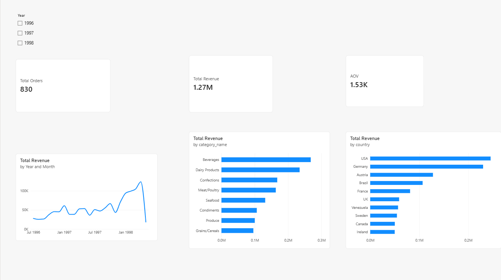
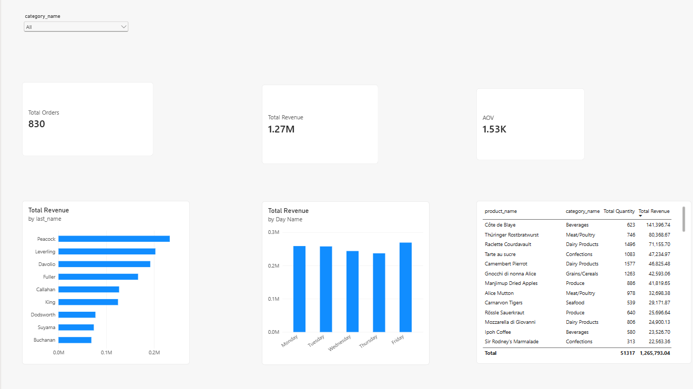
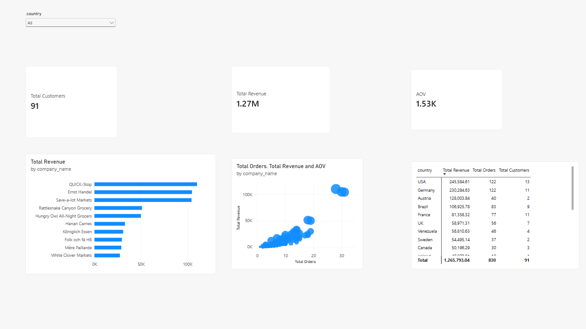

# Northwind Retail Analytics & Business Performance Report

End-to-end analytics project on the classic Northwind trading database. It combines PostgreSQL analysis (CTEs, window functions, segmentation) with a 3-page interactive Power BI dashboard.

**Tools:** PostgreSQL · SQL (CTEs, window functions) · Power BI (DAX)

---

## Dashboard Preview

### Executive Summary


### Sales Analysis


### Customer Analysis


---

## Executive Summary

### 1. Problem Statement

Northwind Traders is an international B2B specialty food distributor. Management faces three questions:

- **Revenue visibility:** how fast is the business really growing, and where does the revenue come from (markets, categories, products)?
- **Inventory risk:** which active products are running below safety stock and risk order unfulfillment?
- **Customer concentration and retention:** how dependent is revenue on a few key accounts, and which customers are going silent?

### 2. Data & Architecture

The analysis uses the core Northwind tables: `orders`, `order_details`, `products`, `categories`, `customers` and `employees`.

- **Fact data:** order lines (`orders` joined with `order_details`); net revenue = `unit_price × quantity × (1 − discount)`.
- **Dimensions:** products and categories (reorder levels, classifications), customers (country, account), employees (sales representatives).
- **Coverage:** 830 orders from 91 customers (89 of them have placed at least one order), from 4 July 1996 to 6 May 1998.

### 3. Methodology

1. **SQL analytics (PostgreSQL):** CTEs, window functions (`DISTINCT ON`, `NTILE`, `LAG`, `SUM() OVER`), aggregations and percentage-of-total calculations, organized in three blocks: Sales & Revenue Trends, Product & Category Performance, Customer & Employee Analytics.
2. **Data modeling (Power BI):** 1-to-many, single-direction relationships between dimension tables and order lines.
3. **Dashboard:** 3 pages (Executive Summary, Sales Analysis, Customer Analysis) with dedicated DAX measures.

### 4. Key Findings

Total net revenue in the period: **1,265,793** across 830 orders.

**Growth**
- Revenue grew **~90%** year over year when comparing the 10 months that exist in both periods (Jul 1997 – Apr 1998 vs. Jul 1996 – Apr 1997). November 1997 was the only month with a decline (−4.5%). The highest month was April 1998 (123,799).

**Markets**
- **USA (19.4%)** and **Germany (18.2%)** are the largest markets; with **Austria (10.1%)** the top three countries generate **47.7%** of revenue.
- Austria ranks third with only 2 customers, and **Ernst Handel** alone generates 82% of it (104,875 of 128,004), so the Austrian market is essentially one account. Its revenue per order (~3,200) is also well above the USA (~2,000) and Germany (~1,900).

**Customer concentration**
- The top 3 customers (QUICK-Stop, Ernst Handel, Save-a-lot Markets) generate **25.2%** of revenue, each around 8–9%. The top 10 customers generate **45.0%**.
- Only one customer (Centro comercial Moctezuma) has ever placed a single order, so the problem is not one-time buyers but **silent accounts**: 16 of 89 customers (18%) have not ordered in 90+ days, and 5 have been silent for 180+ days (measured against the last order date in the data).

**Products and categories**
- **Beverages (21.2%)** and **Dairy Products (18.5%)** lead, together **39.7%** of revenue. Grains/Cereals is the smallest category (7.6%).
- Product revenue is concentrated: **Côte de Blaye** alone generates **11.2%** of total revenue, and the top 5 products **30.6%**.

**Discounts**
- 838 of 2,155 order lines (39%) carry a discount and generate 515,094 (41%) of revenue.
- Discounted lines average **27.1 units** versus **21.7** for non-discounted lines (+25%), and yield about 8% more revenue per line (615 vs. 570) despite the lower price. This is an association only: the data does not show whether discounts cause bigger orders or are granted on them.

**Inventory**
- **17 active products** are at or below their reorder level. Gorgonzola Telino is out of stock (0 units).
- 16 of the 17 already have units on order; only Nord-Ost Matjeshering has nothing on order. Even after pending orders arrive, Nord-Ost Matjeshering and Outback Lager would still sit below their reorder levels.

### 5. Strategic Recommendations

1. **Smarter inventory triggers:** alert on `units_in_stock + units_on_order < reorder_level` instead of stock alone, so products that are already on order do not raise false alarms. Prioritize Gorgonzola Telino (zero stock), Nord-Ost Matjeshering and Outback Lager.
2. **Protect key accounts:** with 25% of revenue in 3 customers, assign dedicated account management and tailor terms for the top spend quartile (`NTILE = 1`).
3. **Win-back campaign:** target the 16 customers inactive for 90+ days, prioritized by their historical spend.
4. **Reduce single-product dependence:** secure supply and a backup supplier for Côte de Blaye (11% of revenue).
5. **Discount audit:** discounted lines carry ~25% more units, but discounts may simply be granted on large orders. Run a like-for-like comparison per product (same product, with vs. without discount) before extending discounts.

### 6. Limitations

- **Partial years:** data covers July 1996 – early May 1998, so 1996 and 1998 are incomplete. Growth is therefore measured month-over-month against the same month of the previous year rather than by calendar year.
- **No cost data:** without cost of goods sold, the analysis measures **revenue**, not profitability.
- **Revenue definition:** figures are net of item discounts and exclude freight.
- **Observational discount analysis:** the discounted vs. non-discounted comparison does not control for product mix or order size, so it cannot prove cause and effect.
- **Small sample:** 830 orders and 89 customers, so shares and rankings are sensitive to individual accounts.
- **Static data:** historical snapshot without live integration.

---

## KPI Metrics Dictionary

| Metric | DAX / Logic | Description | Business Purpose |
|---|---|---|---|
| **Total Revenue** | `SUMX(order_details, unit_price * quantity * (1 - discount))` | Net sales after item discounts, excluding freight | Tracks total net sales |
| **Total Orders** | `DISTINCTCOUNT(orders[order_id])` | Count of unique orders | Measures order volume |
| **Average Order Value (AOV)** | `DIVIDE([Total Revenue], [Total Orders], 0)` | Net revenue per order | Evaluates basket size and spending trends |
| **Total Customers** | `DISTINCTCOUNT(customers[customer_id])` | Count of unique customers | Tracks customer reach |

---

## Repository Structure

```
.
├── northwind_sql_analysis.sql   # all analytical queries (CTEs, window functions)
├── northwind_dashboard.pbix     # Power BI report
├── page1_executive_summary.png  # dashboard screenshots
├── page2_sales_analysis.png
├── page3_customer_analysis.png
└── README.md
```

<details>
<summary>How to reproduce</summary>

1. Load the Northwind sample database into PostgreSQL 
2. Run the queries in `northwind_sql_analysis.sql` (they are grouped in three sections).
3. Open `northwind_dashboard.pbix` in Power BI Desktop and point it to your database.

</details>
